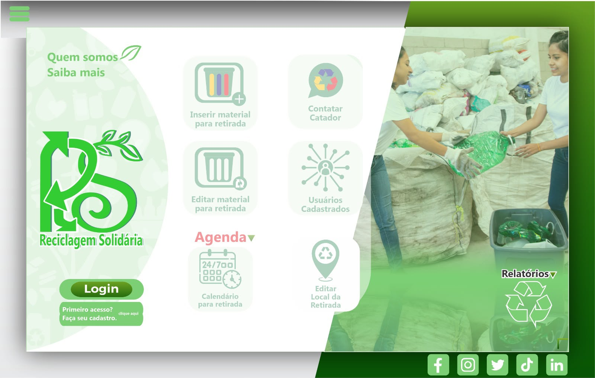
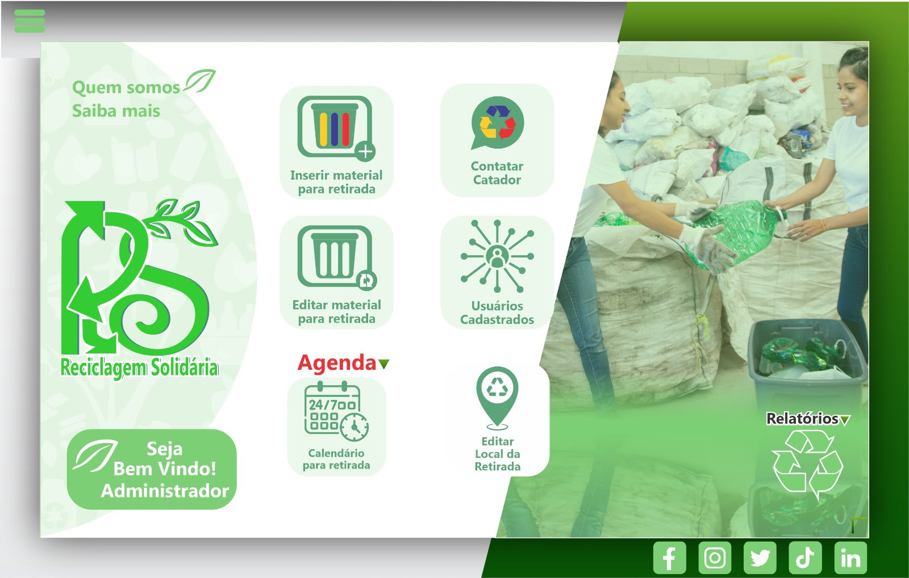
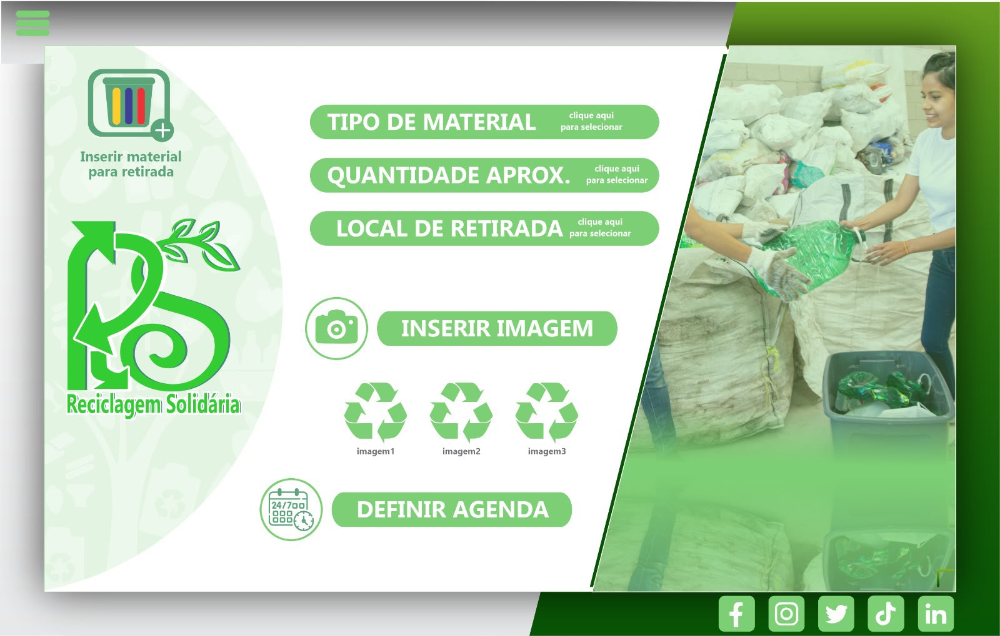
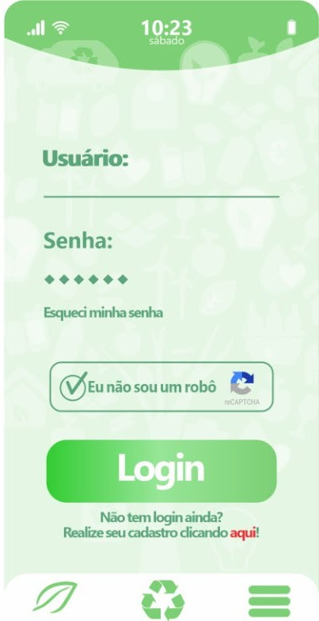
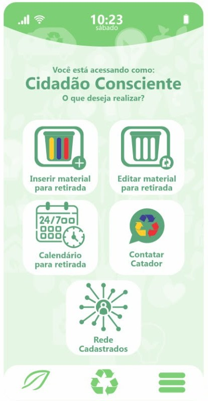
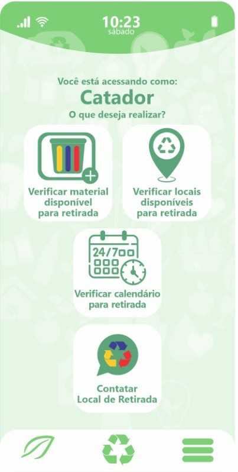

<div align="center">


# Reciclagem Solidária

**Plataforma web que conecta cidadãos que querem descartar recicláveis a catadores autônomos que podem coletá-los.**

Projeto Integrador desenvolvido na **Fatec Franco da Rocha**.


</div>

---

## 📌 Sobre o projeto

Muitos catadores autônomos dependem de encontrar material reciclável por acaso, enquanto muitos cidadãos não sabem a quem entregar o que separam em casa. O **Reciclagem Solidária** aproxima os dois lados:

- o **cidadão** cadastra o material que tem para doar e onde ele pode ser retirado;
- o **catador** vê as ofertas disponíveis, agenda a coleta e acompanha seu histórico;
- a **administração** (Fatec) gerencia catadores, tipos de material, status, publicações e relatórios.

## ✨ Funcionalidades

### 👤 Cidadão
- Cadastro e login com recuperação de senha por e-mail
- Oferta de materiais recicláveis com local de retirada e horários disponíveis
- Acompanhamento das suas ofertas e coletas agendadas
- Troca de mensagens com o catador responsável pela coleta

### ♻️ Catador
- Consulta de materiais disponíveis para coleta
- Agendamento e cancelamento de coletas
- Definição da própria agenda de disponibilidade
- Relatórios pessoais de coletas realizadas

### 🛠️ Administrador
- Cadastro e gestão de catadores e usuários
- Gestão de tipos de material e status de coleta
- Publicação de campanhas e avisos
- Relatórios gerais da plataforma
- Promoção/rebaixamento de administradores, com proteção do administrador principal

### Geral
- **PWA instalável** no celular (manifest + service worker)
- Layout responsivo, com telas pensadas para mobile e desktop
- Controle de acesso por perfil (route guard no front + Row Level Security no banco)
- Política de privacidade e consentimento em conformidade com a **LGPD**

## 🧱 Arquitetura e tecnologias

| Camada | Tecnologia |
| --- | --- |
| Frontend | HTML5, CSS3 com design tokens, JavaScript puro (ES6 modules), sem frameworks nem bundler |
| Backend (BaaS) | [Supabase](https://supabase.com): Auth, PostgreSQL, Storage e Realtime |
| Segurança | Row Level Security (RLS) em todas as tabelas, funções RPC `security definer` e triggers de proteção |
| Mobile | Progressive Web App (manifest + service worker) |
| Deploy | Vercel (site estático) |

O frontend é servido como arquivos estáticos e conversa diretamente com o Supabase pelo SDK `@supabase/supabase-js`. As regras de negócio sensíveis (agendar e cancelar coleta, promover administrador, impedir autopromoção etc.) ficam no banco, em funções PL/pgSQL e políticas RLS, e não no navegador.

### Modelo de dados

```
cidadao ──< local_retirada
   │
   └──< coleta >── materiais
          │  └──── status
          └─────── catador ──< agenda

mensagens · publicacoes
```

O script completo (tabelas, RLS, funções, triggers e dados iniciais) está em [`db/schema.sql`](db/schema.sql).

## 🖼️ Protótipos

| Tela inicial (web) | Painel do administrador | Inserir material |
| --- | --- | --- |
|  |  |  |

| Login (mobile) | Cidadão (mobile) | Catador (mobile) |
| --- | --- | --- |
|  |  |  |

## 📁 Estrutura de pastas

```
├── assets/            # Logos, ícones do PWA e protótipos
├── css/
│   ├── design-tokens.css   # Cores, tipografia e espaçamentos
│   └── style.css           # Estilos compartilhados e layout
├── js/
│   ├── lib/           # Cliente Supabase, route guard, modais, PWA, validações
│   ├── services/      # Acesso a dados (auth, coletas, materiais, agenda, mensagens...)
│   └── pages/         # Lógica de cada tela
├── pages/             # Telas HTML do sistema
├── db/schema.sql      # Script do banco (tabelas, RLS, RPCs, triggers, seeds)
├── index.html         # Página inicial
├── manifest.json      # Manifesto do PWA
├── sw.js              # Service worker
└── vercel.json        # Configuração de deploy
```

## ⚙️ Como rodar localmente

### 1. Servir os arquivos

O projeto usa ES6 modules, então precisa ser servido por HTTP (abrir via `file://` não funciona). Qualquer uma das opções abaixo serve:

```bash
# Python
python -m http.server 8080

# Node
npx serve .
```

Ou use a extensão **Live Server** do VS Code.

### 2. Configurar o banco (Supabase)

1. Crie um projeto no [Supabase](https://supabase.com).
2. No **SQL Editor**, cole o conteúdo de [`db/schema.sql`](db/schema.sql) e execute.
   > ⚠️ O script recria as tabelas do zero (`drop table ... cascade`). Use em um projeto novo ou de testes.
3. Em [`js/lib/supabaseClient.js`](js/lib/supabaseClient.js), substitua `SUPABASE_URL` e `SUPABASE_ANON_KEY` pelos dados do seu projeto (**Project Settings → API**).

> A chave usada no frontend é a chave pública (*publishable/anon*). Ela pode ficar no código, porque o acesso aos dados é controlado pelas políticas de RLS do banco.

### 3. Criar o administrador inicial

1. No Supabase, vá em **Authentication → Users → Add user → Create new user** e informe e-mail e senha.
2. Copie o `UUID` do usuário criado e execute no **SQL Editor**:

```sql
insert into public.cidadao (id, nome, email, nivel_acesso, situacao)
values ('COLE_O_UUID_AQUI', 'Nome do Administrador', 'admin@exemplo.com', 'administrador', 'ativo');
```

Pronto: faça login com esse usuário para acessar o painel administrativo e cadastrar catadores.

## 👩‍💻 Autoria

Desenvolvido por **Thamires Cezar** como Projeto Integrador do curso na **Fatec Franco da Rocha**.

[](https://github.com/thamiresgomescezar)
